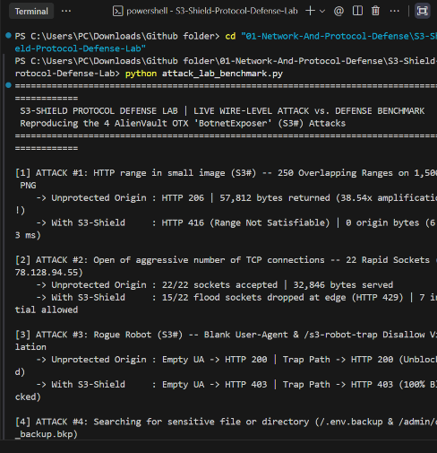

# 🛡️ S3-Shield: Protocol-Level Reverse Proxy & Attack Lab for the 4 `BotnetExposer` (`S3#`) Attacks

> **Zero UI Fluff. Pure Python Protocol Defense Engineering.**
> Reproducing and neutralizing 4 live Internet attack vectors observed in global threat intelligence research at the HTTP/TCP wire level:
> 1. **`HTTP range in small image (S3#)`** *(38.54x Multipart Byte-Range Amplification)*
> 2. **`Open of aggressive number of TCP connections`** *(Socket Pool Exhaustion)*
> 3. **`Rogue Robot (S3#)`** *(Unscrupulous High-Rate Crawlers & `robots.txt` Trap Evasion)*
> 4. **`Searching for sensitive file or directory`** *(Automated `.bkp`, `.env`, and `/admin` Enumeration)*

---

## 🔬 Deep Dive: Why Do Attackers Send `HTTP Range` Requests to a Tiny Image?

While investigating live global threat pulses on **AlienVault OTX**, researcher **`BotnetExposer`** (3,272+ subscribers) repeatedly flagged an unusual attack vector: **`HTTP range in small image`**.

At first glance, requesting byte ranges (`RFC 7233`) on a tiny `1,500-byte` PNG image makes no sense—`Range` headers were designed to resume multi-gigabyte video downloads.

### How the Protocol Amplification Exploit Works
When an attacker sends a single HTTP GET request with **250 overlapping byte ranges** against a tiny `1,500-byte` image:
```http
GET /assets/small_logo.png HTTP/1.1
Host: target-server.com
Range: bytes=0-1, 0-2, 0-3, 0-4, ..., 0-250
```
1. **Bypasses Payload Filters:** The incoming HTTP request is tiny (`~1.3 KB`), easily slipping past standard payload-size limits.
2. **Multipart MIME Explosion:** An unhardened HTTP/S3 origin server splits the `1,500-byte` image into 250 separate slices and wraps **every single slice** in a ~135-byte `multipart/byteranges` MIME boundary header (`--boundary\r\nContent-Type: image/png\r\nContent-Range: bytes 0-1/1500\r\n\r\n`).
3. **38.54x Bandwidth & CPU Amplification:** Our lab (`vulnerable_origin.py`) proves that requesting 250 overlapping ranges on a **`1,500-byte`** image forces the server to compute and transmit **`57,812 bytes`** of `HTTP 206 Partial Content` output—a **38.54x amplification factor** per request!

---

## ⚙️ How `S3-Shield` Neutralizes All 4 Attacks on the Wire

`S3-Shield` ([`src/s3_shield.py`](./src/s3_shield.py)) is a lightweight reverse-proxy defense engine that sits in front of the origin server (`127.0.0.1:9002 -> 127.0.0.1:9001`) and enforces 4 protocol-level defenses before traffic ever touches the origin:

| OTX Attack Vector | MITRE ATT&CK | Protocol Vulnerability | `S3-Shield` Wire-Level Mitigation |
| :--- | :--- | :--- | :--- |
| **1. `HTTP range in small image`** | `T1499.002` | Unrestricted `RFC 7233` multipart `Range` headers on static images cause 38.5x output amplification. | Rejects multi-range (`> 3`), overlapping ranges (`0-10, 2-12`), and micro-slice (`< 16B`) requests on `.png/.jpg/.gif/.svg/.ico` with **`HTTP 416 Range Not Satisfiable`** (`0` origin bytes) and strips `Accept-Ranges` headers. |
| **2. `Open of aggressive number of TCP connections`** | `T1499.001` | Rapid concurrent socket bursts exhaust worker threads & file descriptors. | Tracks per-IP active socket concurrency & sliding-window velocity; drops burst sockets at the edge with **`HTTP 429 Too Many Connections`**. |
| **3. `Rogue Robot (S3#)`** | `T1595.002` | Unscrupulous crawlers hit servers nonstop with blank User-Agents or ignore `robots.txt`. | Blocks blank/rogue User-Agent strings and enforces a `/s3-robot-trap` disallow honeypot URI with **`HTTP 403 Forbidden`**. |
| **4. `Searching for sensitive file or directory`** | `T1595.003` | Scanners enumerate `/.env.backup`, `/admin/db_backup.bkp`, `/backup.zip`, `/.git`. | Circuit-breaker blocks sensitive extensions/paths with **`HTTP 403 Forbidden`** and immediately adds the scanner IP to the active edge blocklist. |

---

## 📊 Live Attack-vs-Defense Benchmark Results



Run the automated benchmark yourself with a single command:

```bash
cd 01-Network-And-Protocol-Defense/S3-Shield-Protocol-Defense-Lab
python attack_lab_benchmark.py
```

### Output (`attack_lab_benchmark.py`)
```text
==============================================================================================
 S3-SHIELD PROTOCOL DEFENSE LAB | LIVE WIRE-LEVEL ATTACK vs. DEFENSE BENCHMARK
 Reproducing the 4 AlienVault OTX 'BotnetExposer' (S3#) Attacks
==============================================================================================

[1] ATTACK #1: HTTP range in small image (S3#) -- 250 Overlapping Ranges on 1,500B PNG
    -> Unprotected Origin : HTTP 206 | 57,812 bytes returned (38.54x amplification!)
    -> With S3-Shield     : HTTP 416 (Range Not Satisfiable) | 0 origin bytes (2.55 ms)

[2] ATTACK #2: Open of aggressive number of TCP connections -- 22 Rapid Sockets (178.128.94.55)
    -> Unprotected Origin : 22/22 sockets accepted | 32,846 bytes served
    -> With S3-Shield     : 13/22 flood sockets dropped at edge (HTTP 429) | 9 initial allowed

[3] ATTACK #3: Rogue Robot (S3#) -- Blank User-Agent & /s3-robot-trap Disallow Violation
    -> Unprotected Origin : Empty UA -> HTTP 200 | Trap Path -> HTTP 200 (Unblocked)
    -> With S3-Shield     : Empty UA -> HTTP 403 | Trap Path -> HTTP 403 (100% Blocked)

[4] ATTACK #4: Searching for sensitive file or directory (/.env.backup & /admin/db_backup.bkp)
    -> Unprotected Origin : HTTP 200 & 200 | Production Secrets Leaked: True
    -> With S3-Shield     : HTTP 403 & 403 | Production Secrets Leaked: False

[5] LEGITIMATE USER CONTROL CHECK (Normal Browser Request for /assets/small_logo.png)
    -> Through S3-Shield  : HTTP 200 OK | 1,493 bytes | Accept-Ranges hardened to 'none' (29.42 ms)

==============================================================================================
 [+] Auto-Generated 4 AlienVault OTX Threat Pulses -> exports/otx_auto_pulse.json
 [+] Total Origin Bandwidth Saved in Single Run: 58,524 bytes
==============================================================================================
```

---

## 🔄 Closing the Loop: Auto-Publishing Pulses Back to AlienVault OTX

Just like `BotnetExposer` publishes its sensor telemetry to OTX, `S3-Shield` automatically formats every blocked attack into a ready-to-submit **AlienVault OTX DirectConnect v1 Pulse JSON** ([`exports/otx_auto_pulse.json`](./exports/otx_auto_pulse.json)), complete with `IPv4` and `FilePath` indicators, MITRE ATT&CK IDs (`T1499.001`, `T1499.002`, `T1595.002`, `T1595.003`), and `TLP:GREEN` tags.

---

## 📂 Project Structure

```text
S3-Shield-Protocol-Defense-Lab/
├── attack_lab_benchmark.py          # Automated Attack-vs-Defense benchmark & wire-level verifier
├── README.md                        # Protocol analysis, architecture & benchmark documentation
├── assets/
│   └── otx_botnet_exposer_pulses.png # Real AlienVault OTX pulse capture
├── exports/
│   └── otx_auto_pulse.json          # Auto-generated OTX Threat Pulses from blocked attacks
└── src/
    ├── vulnerable_origin.py         # Unhardened RFC 7233 HTTP/S3 origin server (Port 9001)
    └── s3_shield.py                 # S3-Shield Reverse Proxy & Protocol Defense Engine (Port 9002)
```
